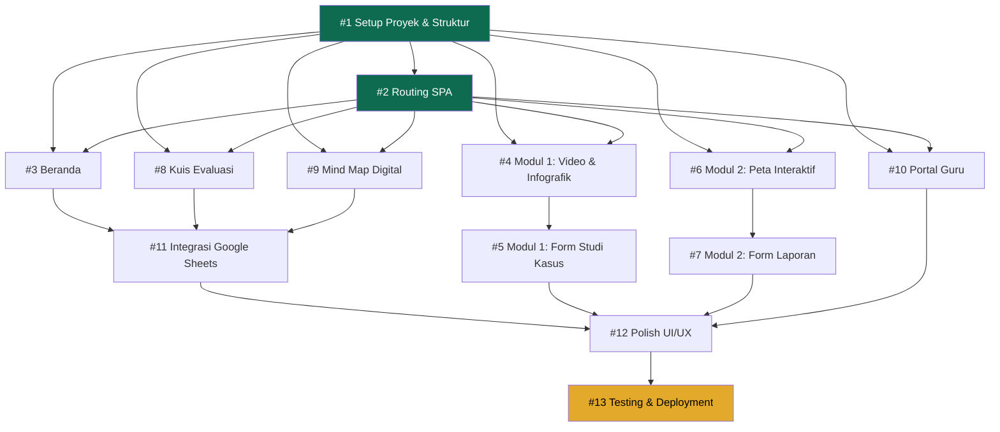

# 🗺️ SiBELA — Roadmap & Issue Tracker

> **Total: 13 Issues** | Tech Stack: Vanilla JS + Tailwind CSS | Deploy: GitHub Pages

---

## 📊 Dependency Graph



---

## 📋 Daftar Issue Lengkap

| # | Issue | Label | Prioritas | Depends On | Mapping PRD | Status |
|---|-------|-------|-----------|------------|-------------|--------|
| 1 | [Setup Proyek & Struktur Dasar](issue1.md) | `setup` `infrastructure` | 🔴 Critical | — | NFR 1-3, FR-02 | ✅ Selesai |
| 2 | [Routing SPA Client-Side](issue2.md) | `core` `routing` | 🔴 Critical | #1 | FR-02, Arsitektur | ✅ Selesai |
| 3 | [Beranda: Nama, Sapaan & Progress Bar](issue3.md) | `feature` `beranda` | 🟠 High | #1, #2 | FR-01, FR-03 | ✅ Selesai |
| 4 | [Modul 1: Video & Infografik Sishankamnas](issue4.md) | `feature` `modul1` | 🟠 High | #1, #2 | FR-04, FR-05 | ⬜ |
| 5 | [Modul 1: Form Studi Kasus Nirmiliter](issue5.md) | `feature` `modul1` `form` | 🟠 High | #4 | FR-06 | ⬜ |
| 6 | [Modul 2: Peta Geopolitik Interaktif](issue6.md) | `feature` `modul2` `peta` | 🟠 High | #1, #2 | FR-07, FR-08 | ⬜ |
| 7 | [Modul 2: Form Laporan & Validasi Sumber](issue7.md) | `feature` `modul2` `form` | 🟠 High | #6 | FR-09 | ⬜ |
| 8 | [Kuis Evaluasi: Soal, Timer & Feedback](issue8.md) | `feature` `kuis` | 🟠 High | #1, #2 | FR-10, FR-11, FR-12 | ✅ Selesai |
| 9 | [Mind Map Digital: Kanvas & Validasi](issue9.md) | `feature` `mindmap` | 🟠 High | #1, #2 | FR-13–FR-16 | ⬜ |
| 10 | [Portal Guru: PIN Auth & Dashboard](issue10.md) | `feature` `portal-guru` | 🟠 High | #1, #2 | FR-17, FR-19 | ⬜ |
| 11 | [Integrasi Google Sheets](issue11.md) | `feature` `integrasi` | 🟠 High | #3, #8, #9 | FR-18 | ⬜ |
| 12 | [Polish UI/UX & Responsivitas Final](issue12.md) | `enhancement` `ui-ux` | 🟡 Medium | #1–#11 | NFR 1-3 | ⬜ |
| 13 | [Testing, Bug Fixing & Deployment](issue13.md) | `testing` `deployment` | 🔴 Critical | #1–#12 | Pekan 6-7 | ⬜ |

---

## 🗓️ Mapping ke Roadmap ADDIE (7 Pekan)

| Pekan | Fase ADDIE | Issues yang Dikerjakan |
|-------|-----------|----------------------|
| **Pekan 1** (7–13 Okt) | Analysis | Finalisasi PRD *(sudah selesai)* |
| **Pekan 2** (14–20 Okt) | Design | Wireframe & Use Case *(sudah selesai)* |
| **Pekan 3** (21–27 Okt) | Development 1 | **#1** Setup, **#2** Routing, **#3** Beranda, **#4** Modul 1 Video, **#5** Studi Kasus |
| **Pekan 4** (28 Okt–3 Nov) | Development 2 | **#6** Peta Interaktif, **#7** Form Laporan, **#8** Kuis Evaluasi |
| **Pekan 5** (4–10 Nov) | Development 3 | **#9** Mind Map, **#10** Portal Guru, **#11** Integrasi Google Sheets |
| **Pekan 6** (11–17 Nov) | Implementation | **#12** Polish UI/UX, Uji Validasi Ahli |
| **Pekan 7** (18–25 Nov) | Evaluation | **#13** Testing, Bug Fix & Deployment Final |

---

## 🔀 Urutan Pengerjaan yang Disarankan

```
Fase 1 (Fondasi):     #1 → #2
Fase 2 (Paralel):     #3 | #4 | #6 | #8 | #9 | #10  (bisa dikerjakan paralel)
Fase 3 (Lanjutan):    #5 (setelah #4) | #7 (setelah #6)
Fase 4 (Integrasi):   #11 (setelah #3, #8, #9)
Fase 5 (Polish):      #12
Fase 6 (Release):     #13
```

---

## 📐 Tujuan Pembelajaran (TP) Coverage

| Tujuan Pembelajaran | Issues Terkait | Fitur Utama |
|---------------------|---------------|-------------|
| **TP 10.D.6** — Sishankamnas & Ancaman Nirmiliter | #4, #5 | Video, Infografik, Form Studi Kasus |
| **TP 10.D.7** — Peran Indonesia di Dunia | #6, #7 | Peta Interaktif, Form Laporan |
| **TP 10.D.8** — Mind Map & Presentasi | #9 | Kanvas Mind Map, Simpulan UUD 1945 |
| **Evaluasi (KKTP)** | #8 | Kuis Timer, Skor ≥ 75 |
